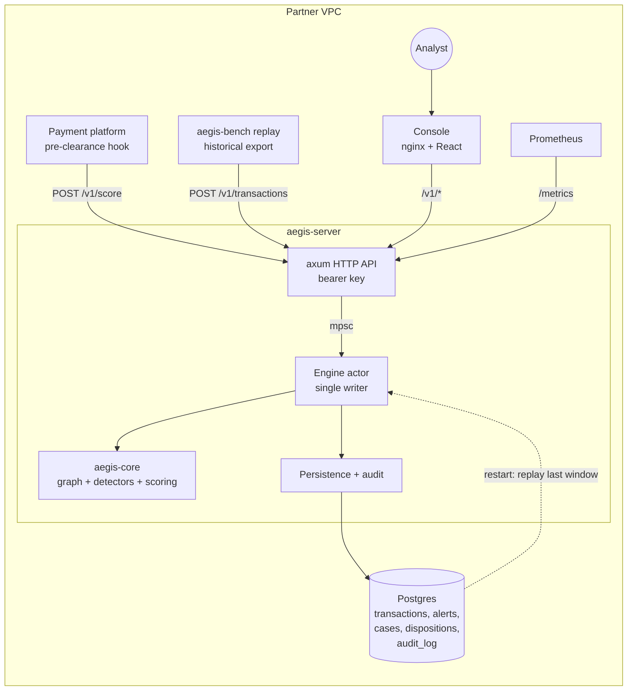

# AegisGraph architecture

AegisGraph scores each payment against an in-memory, time-windowed graph of recent payments and shared identifiers,
and returns a decision with the graph path that explains it. One Rust process, one Postgres, one static web console.

## Dataflow

## Crates
- `aegis-core`: zero IO. Graph, detectors, scoring, config. The server and the benchmark call the exact same code path,
  so benchmark numbers describe production behaviour.
- `aegis-server`: HTTP API, Postgres persistence, audit log. Contract: [`docs/api.md`](api.md).
- `aegis-bench`: dataset benchmark (recall/latency report) and the partner replay tool (`replay --target`).
- `console/`: Vite + React + Cytoscape.js investigator UI, served by nginx, which also proxies `/v1` to the engine.

## Engine internals
- **Nodes.** Accounts plus shared identifiers: device (`device:<id>`), IP (`ip:<addr>`) and hashed customer
  (`cust:<hash>`). External string IDs are interned to `u32`s.
- **Time-windowed graph.** Each node keeps time-ordered in/out adjacency (`payment` edges between accounts, `uses`
  edges from accounts to identifiers). The watermark is the latest `ts_ms` seen; edges older than
  `watermark − window_ms` (default 72 h) are evicted, so memory is bounded by traffic in the window, not by history.
- **Hub tagging.** A node whose in-window degree reaches `hub_degree` (default 500) is flagged HUB. Hubs keep their own
  aggregates (fan-in, velocity) but are never expanded during traversal: merchants, payroll providers and shared office
  IPs cannot blow up a search or connect everyone to everyone.
- **Bounded BFS.** Cycle detection runs, for a new edge u→v, a search for a time-ordered path v→…→u of at most
  `max_hops` (2–4), skipping hubs and stopping after `budget` edge visits. Worst-case work per transaction is a
  constant, so latency stays flat on dense graphs (at the cost of possibly missing a cycle hidden behind the budget).
- **Detectors.** `cycle`, `mule_fan_in`, `pass_through`, `fan_out`, `velocity`, `shared_identifier`. Each returns a
  finding: confidence in [0, 1], a one-sentence reason, and the edge path that is the evidence.
- **Noisy-OR scoring.** `score = 1 − ∏(1 − wᵢ·sᵢ)` over findings with per-rule weights `wᵢ`. Monotonic (another finding
  never lowers the score), bounded in [0, 1], and explainable (each rule's contribution is visible). Config bands map
  the score to `allow` / `review` / `block`.
- **Concurrency.** The graph is owned by one actor fed by an mpsc channel: deterministic ordering, no locks. Scaling
  out later means sharding by account hash, not adding writers to one graph.

## Persistence and restart
- `transactions` is append-only. Alerts, findings, cases, notes and dispositions are ordinary tables (sqlx migrations
  are embedded in the binary).
- The graph is not persisted. On start the engine replays the transactions inside the last window from Postgres to
  rebuild it, so a restart detects the same patterns as before without snapshots or Kafka offsets.
- Hence exactly one engine per database (Helm pins `replicas: 1`, `Recreate`).

## Audit hash chain
Every state change appends an `audit_log` row: `hash = sha256(prev_hash ‖ canonical_json(payload) ‖ action ‖ entity_id)`,
genesis `prev_hash` = 64 zeros. Rows are never updated or deleted. `GET /v1/audit/verify` recomputes the chain and
reports the first broken row, giving examiners tamper evidence for every score, alert and analyst decision.

## Extension seams (not built in the pilot)
- **ML scoring.** `aegis_core::MlScorer` trait (no-op by default; `Rule::Ml` reserved). A future implementation loads an
  ONNX temporal graph network (TGN) and contributes one more weighted finding to the same noisy-OR, trained on the
  disposition labels analysts produce.
- **Streaming ingest.** A Kafka/Redpanda consumer behind a cargo feature flag, feeding the same actor as the HTTP API.
- **Enterprise (`ee/`).** OIDC/SAML SSO, SAR narrative generation, HA/replication, consortium risk sharing. Commercial,
  outside the BSL core.

## Deployment
`deploy/docker-compose.yml` (postgres + engine + console) for pilots; `deploy/helm/aegisgraph` for Kubernetes with an
external Postgres. The engine image is distroless and runs as non-root. See [`docs/pilot.md`](pilot.md).
